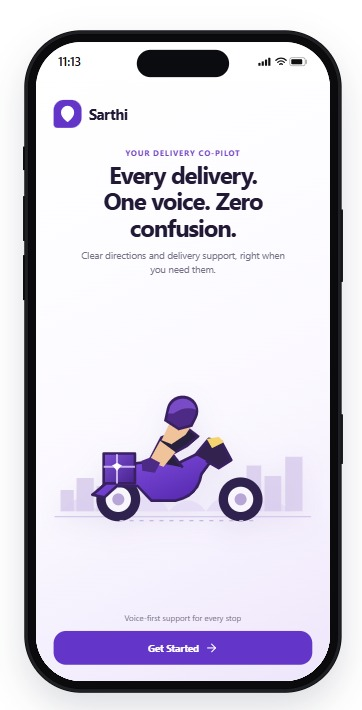
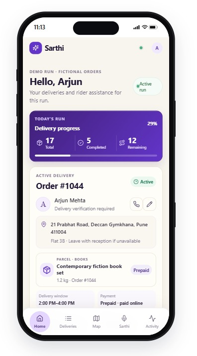
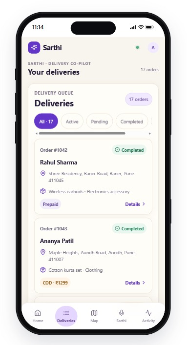
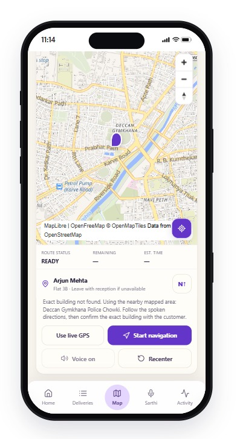
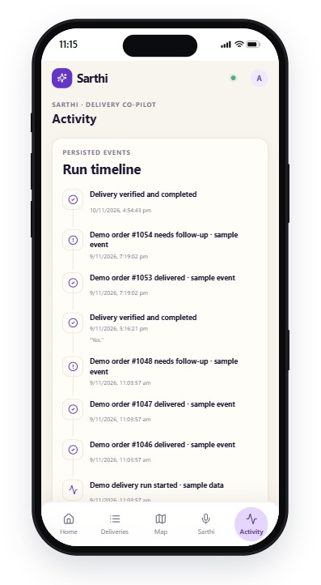

# Sarthi — Voice Co-Pilot for Delivery Riders

Sarthi is a mobile-first voice assistant prototype for e-commerce delivery riders. It helps a rider review a delivery run, get spoken route guidance, record delivery exceptions, and complete a stop only after backend OTP verification.

The application uses fictional local sample data. It is not connected to a live dispatch platform, production customer records, or a production logistics system.

## Product goals

Delivery riders handle many small tasks between stops: checking addresses and access notes, contacting customers, reporting exceptions, and updating order status. Repeatedly using a phone for those tasks adds friction during a shift.

Sarthi provides a voice-first interface for common delivery workflows. The language model interprets a rider's request and proposes an action. The FastAPI backend remains responsible for validating delivery state changes. In particular, a delivery can only be completed after the backend verifies its OTP.

## Features

- **Run overview** — view the active run, delivery progress, current stop, next stop, and recent activity.
- **Delivery management** — review pending, active, completed, and exception stops, and open parcel and customer details.
- **Voice assistant** — use the foreground “Hello Sarthi” wake phrase where browser speech recognition is supported, or use the manual microphone. Prisma transcribes commands, the configured decision provider interprets them, and Timbre speaks responses.
- **Exception reporting** — record supported customer contact, address, and rescheduling issues through the backend action endpoint.
- **OTP-gated delivery completion** — submit the spoken or entered OTP to the backend. The backend validates the code before changing a stop to delivered.
- **In-app navigation** — render an interactive MapLibre map using OpenFreeMap tiles, browser geolocation, address lookup, GraphHopper road routes, and spoken turn instructions.
- **Activity timeline** — review persisted run and delivery activity from the backend.
- **Demo calling** — customer call actions open an in-app simulated call screen for four seconds. The prototype does not place a telephone call or open the device dialer.

## Technology

| Area | Technology |
| --- | --- |
| Frontend | React 18, TypeScript, Vite, Lucide React |
| Backend | Python, FastAPI, Pydantic Settings |
| Database | SQLAlchemy; SQLite by default for local development |
| Speech-to-text | Gnani Prisma (`prisma-v3.0`) |
| Intent understanding | Groq-hosted `openai/gpt-oss-120b` by default; optional Gemini provider is supported by backend configuration |
| Text-to-speech | Gnani Timbre (`timbre-v3.0`) |
| Interactive map | MapLibre GL JS with OpenFreeMap / OpenStreetMap-compatible tiles |
| Geocoding and routing | GraphHopper by default; optional public OSM demo mode is documented in [frontend/NAVIGATION_SETUP.md](frontend/NAVIGATION_SETUP.md) |

Evon is not used by the current intent-understanding path. The configured default is Groq.

## Repository layout

```text
Sarthi/
├── backend/
│   ├── app/
│   │   ├── api.py             # Run, stop, exception, OTP, and contact APIs
│   │   ├── evon.py            # Voice intent API and configured decision provider
│   │   ├── main.py            # FastAPI app, SQLite schema setup, demo seed
│   │   ├── models.py          # SQLAlchemy run, stop, and activity models
│   │   ├── navigation.py      # Geocoding and route APIs
│   │   ├── settings.py        # Backend environment settings
│   │   └── voice.py           # Prisma transcription and Timbre speech APIs
│   ├── migrations/            # Alembic migration setup
│   ├── tests/                 # Backend API, voice, navigation, and seed tests
│   ├── .env.example
│   └── requirements.txt
└── frontend/
    ├── src/
    │   ├── components/        # Layout, delivery, activity, map, and voice UI
    │   ├── pages/              # Welcome, deliveries, map, activity, assistant
    │   ├── App.tsx             # Screen composition and voice-session state
    │   ├── api.ts              # Typed frontend API calls
    │   └── recorder.ts         # Browser microphone recording
    ├── .env.example
    ├── NAVIGATION_SETUP.md
    └── package.json
```

## Architecture and data flow

```text
React app
  ├── Fetches run, stop, and activity data ───────────────► FastAPI
  ├── Records rider audio ─► FastAPI ─► Gnani Prisma
  ├── Sends transcript and delivery context ─► FastAPI ─► decision provider
  ├── Requests spoken response ─► FastAPI ─► Gnani Timbre
  └── Requests geocoding and route data ─► FastAPI ─► GraphHopper

FastAPI ─► SQLAlchemy ─► SQLite (default local database)
```

Voice integrations and decision-provider credentials stay on the backend. The browser sends recorded audio to FastAPI and receives the transcription result. The backend builds delivery context for intent interpretation and excludes sensitive fields such as stored OTP values and customer phone numbers from model context. The model returns a structured intent and proposed action; backend delivery endpoints independently validate any state-changing action.

### Delivery state and OTP

The core database tables are:

- `delivery_runs` — rider, run status, demo marker, and start time.
- `delivery_stops` — order, customer, address, parcel, payment, status, exception reason, and backend-only OTP.
- `activities` — persisted run and stop events with timestamps and optional transcript text.

The local SQLite startup seed creates or repairs the fictional demo run. Seeded demo stops use **4821** as their four-digit test OTP. The regular stop API response exposes `otp_length`, not `otp_code`. Never use the demo code as a production credential.

Supported stop actions include contact attempt, wrong address, reschedule request, and delivery completion. Repeating the same exception action is idempotent. Delivered stops cannot be changed again. A completion request without the correct OTP is rejected and does not mark the stop delivered.

## Requirements

- Python 3.10 or newer (Python 3.11 recommended).
- Node.js 18 or newer and npm.
- A modern browser with microphone and geolocation support for voice and map features.
- Gnani API access for Prisma and Timbre.
- A Groq API key for the default decision provider.
- A GraphHopper API key for the default geocoding and routing provider.

The map requires a secure browser context for geolocation. `localhost` and `127.0.0.1` are treated as secure contexts during local development. Production use requires HTTPS.

## Configure environment variables

### Backend

From the repository root in PowerShell:

```powershell
Copy-Item backend/.env.example backend/.env
```

Edit `backend/.env` and configure the required values:

```dotenv
# For local SQLite development, use this value (or remove DATABASE_URL to use the default):
DATABASE_URL=sqlite:///./sarthi.db

GNANI_API_KEY=your_gnani_key
GNANI_BASE_URL=https://api.vachana.ai
PRISMA_MODEL=prisma-v3.0
TIMBRE_MODEL=timbre-v3.0
TIMBRE_VOICE=Avinash

DECISION_PROVIDER=groq
GROQ_API_KEY=your_groq_key
GROQ_BASE_URL=https://api.groq.com/openai/v1
GROQ_MODEL=openai/gpt-oss-120b

ROUTING_PROVIDER=graphhopper
GRAPHHOPPER_API_KEY=your_graphhopper_key

FRONTEND_ORIGIN=http://127.0.0.1:5173
```

The checked-in `.env.example` contains a PostgreSQL-shaped `DATABASE_URL` example. Replace it with the SQLite value above for the default local setup; otherwise the application will try to connect to that PostgreSQL URL. PostgreSQL can be used by setting `DATABASE_URL` to a valid PostgreSQL connection string, but local setup does not require PostgreSQL or Supabase.

Keep provider keys in `backend/.env` only. Do not add keys to frontend variables, source files, screenshots, or commits. The repository ignores local environment files.

The backend also supports `DECISION_PROVIDER=gemini` with `GEMINI_API_KEY` and `GEMINI_MODEL`, if you intentionally choose that provider. Groq is the default.

### Frontend

Create `frontend/.env.local` with the backend URL:

```dotenv
VITE_API_URL=http://127.0.0.1:8001
```

This is a public backend URL, not a secret. Do not put API keys in any `VITE_` variable because frontend variables are bundled into browser code.

## Run locally

Open two PowerShell terminals from the repository root.

### 1. Start FastAPI

```powershell
cd backend
python -m venv .venv
.\.venv\Scripts\Activate.ps1
python -m pip install -r requirements.txt
Copy-Item .env.example .env
# Edit .env: set DATABASE_URL=sqlite:///./sarthi.db and add provider keys.
uvicorn app.main:app --host 127.0.0.1 --port 8001 --reload
```

If PowerShell blocks virtual environment activation, use a permitted execution policy for the current terminal or run the environment's Python directly with `.venv\Scripts\python.exe`.

FastAPI starts at `http://127.0.0.1:8001`. Interactive API documentation is available at `http://127.0.0.1:8001/docs`.

### 2. Start Vite

```powershell
cd frontend
npm install
# Create .env.local with VITE_API_URL=http://127.0.0.1:8001 if not already present.
npm run dev -- --host 127.0.0.1
```

Open the URL printed by Vite, usually `http://127.0.0.1:5173`. The branded welcome screen appears on each fresh frontend load; select **Get Started** to enter the app for that session.

## Navigation setup

The default `ROUTING_PROVIDER=graphhopper` requires `GRAPHHOPPER_API_KEY` in `backend/.env`. The key stays on the server and is never sent to the browser. Map tiles are provided separately by OpenFreeMap; loading tiles does not calculate a route.

For local evaluation without a GraphHopper key, see [frontend/NAVIGATION_SETUP.md](frontend/NAVIGATION_SETUP.md) for the documented `ROUTING_PROVIDER=osm_demo` option. That mode uses public Nominatim and OSRM services; it is rate limited and has no availability guarantee, so it is not suitable for production.

To try navigation:

1. Start the backend and frontend.
2. Allow location access in the browser while the app is open.
3. Select a delivery and open the Map screen.
4. Start navigation and retry if the address lookup or route provider reports an error.

Sarthi does not fabricate route geometry when geocoding or routing fails. Browser navigation requires the tab to remain open and in the foreground; it does not provide guaranteed background tracking, live traffic, or motorcycle-specific routing.

## API overview

The frontend currently uses these backend endpoints:

| Endpoint | Purpose |
| --- | --- |
| `GET /api/run/active` | Fetch the active delivery run, stops, and activity |
| `PATCH /api/stops/{stop_id}/contact` | Save a customer contact number |
| `POST /api/stops/{stop_id}/actions` | Record an exception action or submit OTP-protected completion |
| `POST /api/voice/transcribe` | Transcribe a browser recording with Prisma |
| `POST /api/voice/understand` | Interpret a transcript with the configured decision provider and run context |
| `POST /api/voice/speak` | Generate WAV speech with Timbre |
| `GET /api/navigation/geocode?q=...` | Resolve a stored delivery address to coordinates |
| `POST /api/navigation/route` | Request a route and instructions from the configured routing provider |

The backend has no production authentication or dispatch integration in this prototype. Do not expose this API to public or production traffic without adding appropriate authentication, authorization, rate limiting, and operational controls.

## Tests and build

Run backend tests from `backend/`:

```powershell
python -m unittest discover -s tests -v
```

Build the frontend from `frontend/`:

```powershell
npm run build
```

The backend tests cover stop actions and OTP validation, demo seed behavior, voice-provider contracts, and navigation API behavior. Browser-only behavior such as microphone permissions, live Prisma transcription, Timbre playback, and geolocation still needs manual testing with configured credentials and a supported browser.

## Security notes

- Keep Gnani, Groq/Gemini, and GraphHopper keys in `backend/.env`.
- Never expose stored OTP values through ordinary API responses or model context.
- Do not use fictional seeded customer data as real customer information.
- Add authentication and rider/run authorization before connecting real accounts or deploying beyond a trusted demo environment.

## Product Screens

The following mobile UI captures show the welcome screen, run overview, delivery queue, map, and activity timeline. Screens showing sample orders use fictional seeded data.

| Welcome | Run overview |
| --- | --- |
|  |  |

| Delivery queue | Route navigation |
| --- | --- |
|  |  |
| Activity Timeline | 
| --- | 
|  |


